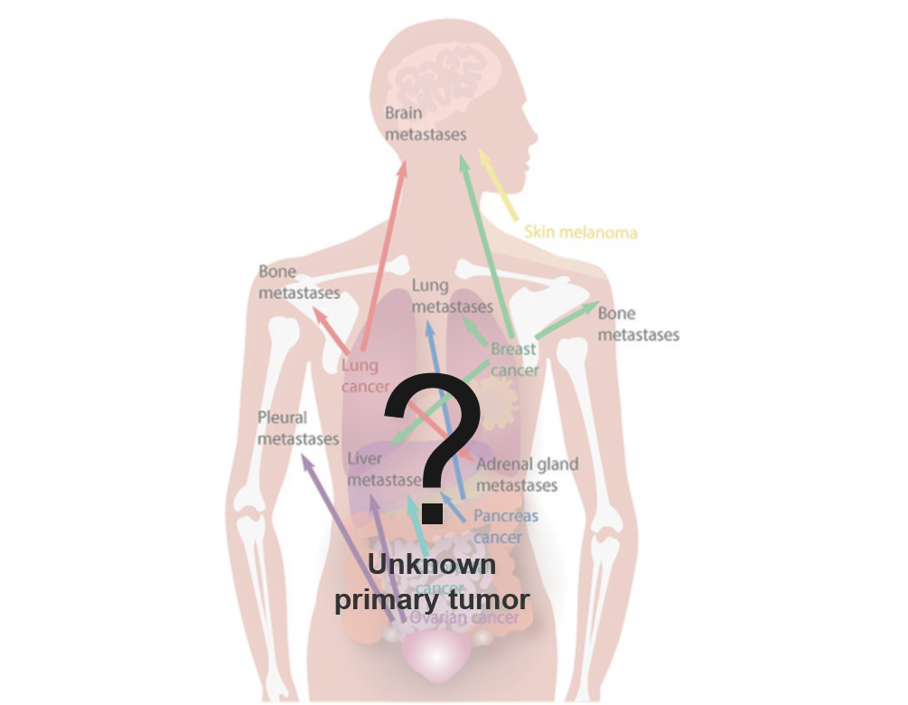
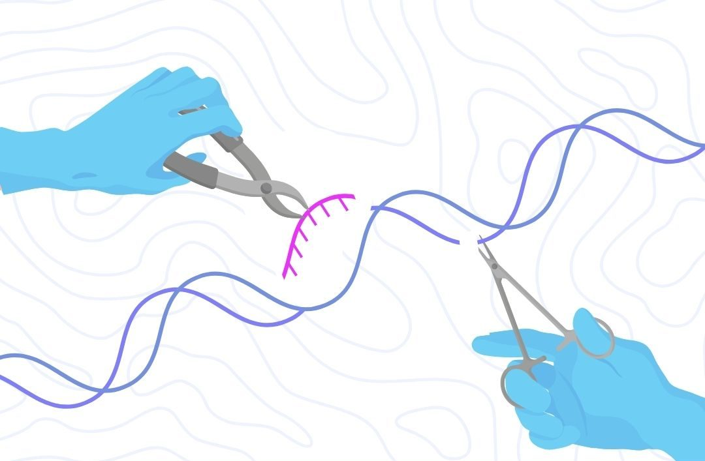
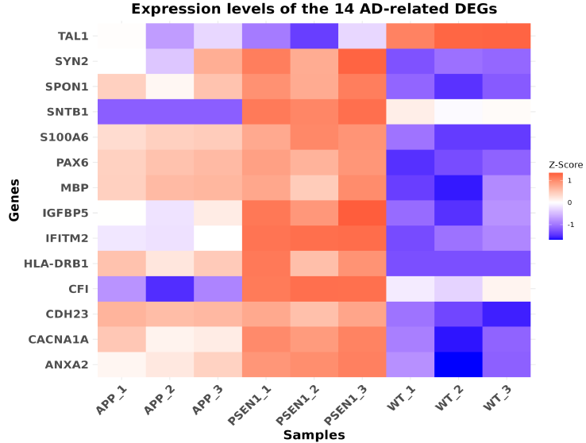
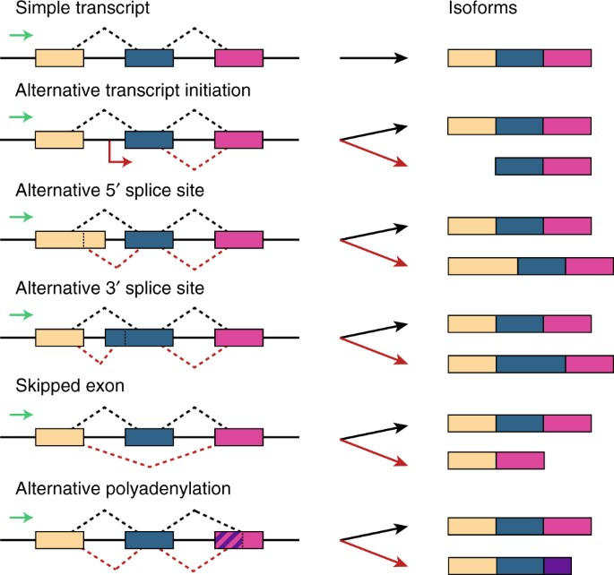
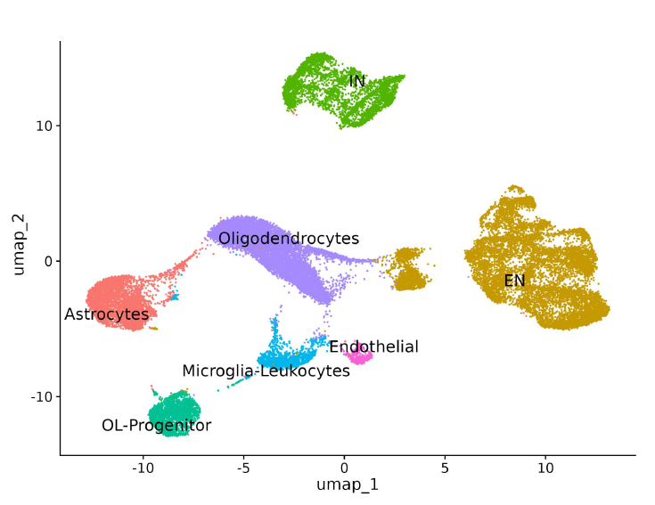

## Hi there 👋

**Hello, I'm Lucía! Nice to meet you.**
I am Spanish, I grew up in Alcorcón, just south of Madrid, a place that somehow combines the energy of a big city with the familiarity of a neighborhood where everything feels close 🏠.

My curiosity about science started with a very simple question: **why was I the only redhead in my family?** 👩🏻‍🦰

Years later, a biology lesson in high school finally gave me an answer, and that curiosity eventually led me to study **Biotechnology** at the Polytechnic University of Madrid (UPM), where I specialized in Computational Biotechnology. Somewhere between biology, programming and large datasets, I discovered bioinformatics. My first contact with it came at the National Center for Biotechnology (CNB-CSIC) in Madrid, where I supported different research groups across the institute. The variety was what I enjoyed most: one day I could be working with transcriptomic data, another exploring metagenomics or structural predictions. It was also where many of the tools I had learned at university became real: HPC environments, data cleaning, pipelines and visualizations were no longer exercises, they were part of answering actual biological questions.

After that, two years ago, I packed my things and moved to Copenhagen to pursue an **MSc in Bioinformatics** at Technical University of Denmark (DTU). It turned out to be one of the best decisions I have made. Professionally, it pushed me far outside what I already knew; personally, it taught me that some of the best things happen when you step outside your comfort zone.

Finding my first job in Denmark was not quite as straightforward. It was actually in a restaurant. It doesn't appear particularly relevant to bioinformatics on paper, but it taught me how to work with people, take responsibility, and adapt quickly to completely new environments. Once I had found my footing in Copenhagen, other opportunities started appearing. A year after taking Introduction to Systems Biology myself, I returned to the course as a Teaching Assistant. Suddenly being on the other side of the classroom, explaining concepts, debugging problems, and helping students was a surprisingly rewarding experience.

I also joined **DTU BioBuilders**, DTU's iGEM team. Our project, [NomNomNylon](https://2025.igem.wiki/dtu-denmark/), explored how synthetic biology could contribute to a more circular textile industry by upcycling nylon waste into useful products such as indigoidine. For me, iGEM was as much about the people as the science. At the end of the journey, we brought home not only the Best Fashion & Cosmetics Project award and a Top 10 Best Wiki recognition, but also a much stronger sense of collaboration and what can happen when a group of committed students with very different skills works toward the same goal.

Another opportunity started with a much smaller step: an email to the Department of Genomic Medicine at **Rigshospitalet**, driven by my interest in genetics and initially just asking whether I could do a special course there. That email eventually turned into one of my most valuable professional experiences. My first project was to automate an analysis that laboratory staff were performing manually as part of their routine. I developed a Shiny application, containerized it with Docker, and turned the analysis into a tool that could be used directly by the laboratory, saving hours of work. After the project, I stayed in the department as a Student Assistant. My next assignment was very different: build a complete web application, frontend and backend included. That experience probably describes quite well how I like to work: I enjoy being given a problem slightly outside what I already know and figuring out what I need to learn to solve it.

I eventually stayed at Rigshospitalet for my MSc thesis as well. There, I moved closer to machine learning and worked on cancer of unknown primary (CUP) classification, exploring the use of variational autoencoders (VAEs) to learn representations of high-dimensional molecular data and investigate whether they could improve tumour classification. What made the project especially meaningful to me was the problem behind the models. CUP refers to patients whose cancer is detected but whose primary tumour cannot be identified, which makes diagnosis and treatment particularly challenging. It was also the first project where I had the time to really get lost in a machine-learning problem: trying ideas that did not work, questioning results that initially looked promising, going back to the data, and slowly building an intuition for what the models were actually learning. I enjoyed that process much more than I expected.

Not everything I have done in Copenhagen has involved code or genomic data, though.

Living at Basecamp Lyngby has also become an important part of my life in Copenhagen. It is not only where I live, but also where I work, helping organize activities and events for an international student community. Working there has also taught me something that is easy to underestimate in technical environments: getting people together, communicating clearly, and creating a sense of community are skills too.

Looking back, there is not really one carefully planned line connecting everything I have done.

The common thread is probably **curiosity**.

I like understanding how things work, I like learning things I do not yet know how to do, and I especially like using data and computation to solve biological problems. And, that is more or less what you will find here!

## Selected Projects
<table>
<tr>
<td width="20%" align="center" valign="middle">
  
</td>
<td width="50%" valign="middle">

<h4>Deep Learning Approaches for Cancer of Unknown Primary (CUP) Classification</h4>

Developed deep learning approaches to predict the tissue of origin of cancers of unknown primary (CUP) from RNA-seq data, exploring variational autoencoders (VAEs) and contrastive learning to generate compact gene expression representations for classification. Evaluated model generalization using an independent cohort of metastatic cancer samples.

<code>Pytorch</code> <code>Variational Autoencoders</code> <code>Contrastive Learning</code>

&nbsp;

</td>
</tr>
</table>

<table>
<tr>
<td width="20%" align="center" valign="middle">
  
</td>
<td width="50%" valign="middle">

<h4>Automation and Visualization of CRISPResso2 Analysis</h4>

Developed a containerized Shiny application to automate CRISPResso2-based analysis of CRISPR genome-editing experiments, streamlining data processing and providing interactive visualizations to facilitate the interpretation of editing outcomes.

<code>Shiny</code> <code>Docker</code> <code>CRISPResso2</code>

</td>
</tr>
</table>

<table>
<tr>
<td width="20%" align="center" valign="middle">
  
</td>
<td width="50%" valign="middle">

<h4>Transcriptomic Analysis of APP- and PSEN1-Related Familial Alzheimer's Disease</h4>

RNA-seq analysis of familial Alzheimer's disease associated with APP and PSEN1 mutations, combining differential gene expression, gene set enrichment, and network analysis to identify shared and mutation-specific transcriptional changes and molecular pathways potentially involved in disease pathology.

<code>FastQC</code> <code>Trimmomatic</code> <code>Kallisto</code> <code>DESeq2</code> <code>fgsea</code> 

</td>
</tr>
</table>

<table>
<tr>
<td width="20%" align="center" valign="middle">
  
</td>
<td width="50%" valign="middle">

<h4>Predicting Isoform Expression from Gene-Level Profiles using Representation Learning</h4>

Explored deep learning approaches to predict transcript isoform expression
from bulk RNA-seq gene-level profiles, comparing neural network architectures
(FFNNs, ResNets, and Transformers) and representation learning techniques
(PCA, VAEs, and BulkFormer).

<code>Python</code> <code>PyTorch</code> <code>Deep Learning</code>

&nbsp;

</td>
</tr>
</table>

<table>
<tr>
<td width="20%" align="center" valign="middle">
  
</td>
<td width="50%" valign="middle">

<h4>Comparative snRNA-seq Analysis of Control and Multiple Sclerosis Brain Tissue</h4>

Performed a comparative single-nucleus RNA-seq analysis of healthy and multiple sclerosis brain tissue, investigating cell-type composition, differential gene expression, pathway enrichment, oligodendrocyte trajectories, and cell-cell communication to characterize disease-associated cellular and transcriptional changes.

<code>Single-cell</code> <code>R</code> <code>Seurat</code> <code>CellChat</code>

&nbsp;

</td>
</tr>
</table>

